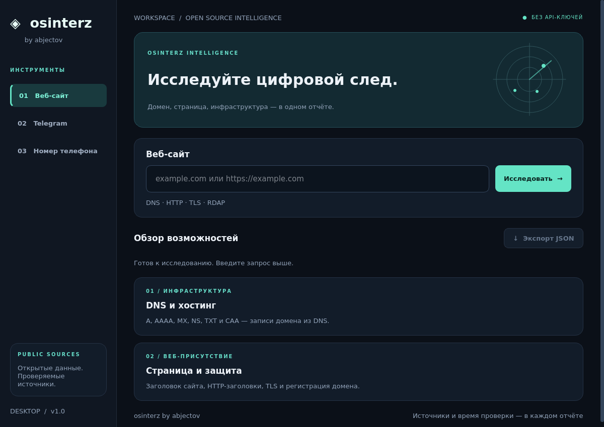

# osinterz by abjectov

Нативное Windows-приложение с тёмным интерфейсом, бирюзовыми акцентами и проверками по открытым источникам. Python 3.12 + PySide6.



## Скачать EXE

В репозитории откройте **Actions → Build osinterz Windows → успешный запуск для ветки osinterz-by-abjectov → Artifacts → osinterz-windows**. Распакуйте ZIP и запустите `osinterz-by-abjectov.exe`. Требуется вход в GitHub для скачивания артефакта. Сборка появляется только после успешного завершения workflow; срок хранения — 30 дней. Windows 10/11 x64. Готовый EXE не требует Python. Сборка не подписана цифровой подписью.

Если автоматическая сборка недоступна, установите **Python 3.12 x64** с python.org, скачайте ветку через **Code → Download ZIP**, распакуйте и запустите `osinterz/build-windows.bat`. Файл появится в `osinterz/dist/osinterz-by-abjectov.exe`.

## Что работает

- **Сайт**: A/AAAA/MX/NS/TXT/CAA, HTTP-статус, заголовок и описание страницы, заголовки безопасности, проверенный TLS-сертификат и RDAP-события регистрации. URL поддерживает IDN-домены. Проверяются стандартные порты 80/443; внутренние адреса не поддерживаются.
- **Telegram**: публичные название, описание и информация карточки `t.me/username`, без авторизации. Поддерживает `@username` и ссылки. Закрытая или недоступная карточка не считается доказательством отсутствия аккаунта.
- **Номер**: международный формат, валидность по плану нумерации, страна, исходный оператор, регион и часовые пояса по префиксу. Поддерживаются международные номера, включая +380, +7, +375, +373, +374, +994, +995, +996, +992, +993 и +998. Нужен явный код страны с `+`.
- **Отчёт**: экспорт JSON с источниками, результатами, ошибками и временем проверки UTC. Проверки идут в фоновом потоке; окно остаётся отзывчивым. История запросов на диск автоматически не записывается.

## Ограничения источников

Это инструмент метаданных из открытых источников, а не поиск по утечкам. Владельцы телефонов, адреса проживания, скрытые Telegram-телефоны и связи между номером и аккаунтами не определяются. География номера — справочная по префиксу, не геолокация человека. Перенос номера может изменить оператора. Валидность формата не подтверждает, что номер существует или активен. RDAP доступен не для всех зон и обычно требует регистрируемый домен, а не субдомен. HTTP/TLS описывают ответ источника на момент запроса, а не полную оценку безопасности сайта. Отсутствующий защитный заголовок не доказывает уязвимость.

Сетевые запросы выполняются к введённому сайту, системному DNS, rdap.org и указанному им RDAP-сервису либо t.me. Номера проверяются локально библиотекой libphonenumber и не отправляются в сеть. Нет телеметрии, API-ключей и входа в Telegram. Тайм-ауты сетевых операций — 8 секунд; DNS-записи проверяются последовательно, поэтому общая проверка может занять дольше. Публичные сайты видят обычный запрос и IP вашего подключения.

## Запуск из исходников

```bash
python -m venv .venv
# Windows:
.venv\Scripts\python -m pip install -r requirements.txt
.venv\Scripts\python app.py
# Linux:
.venv/bin/pip install -r requirements.txt
.venv/bin/python app.py
```

## Проверка

```bash
python -m pip install pytest
python -m pytest -q
```

Тесты используют локальные фикстуры и не обращаются к личным профилям или реальным телефонным номерам. Сборка Windows запускает их перед упаковкой.
